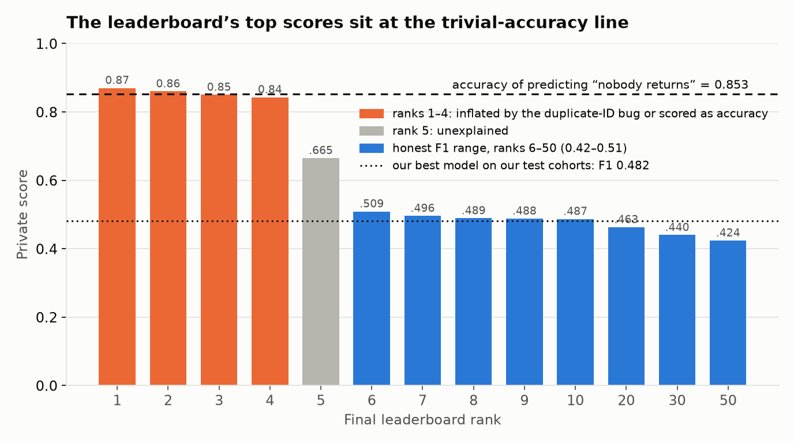
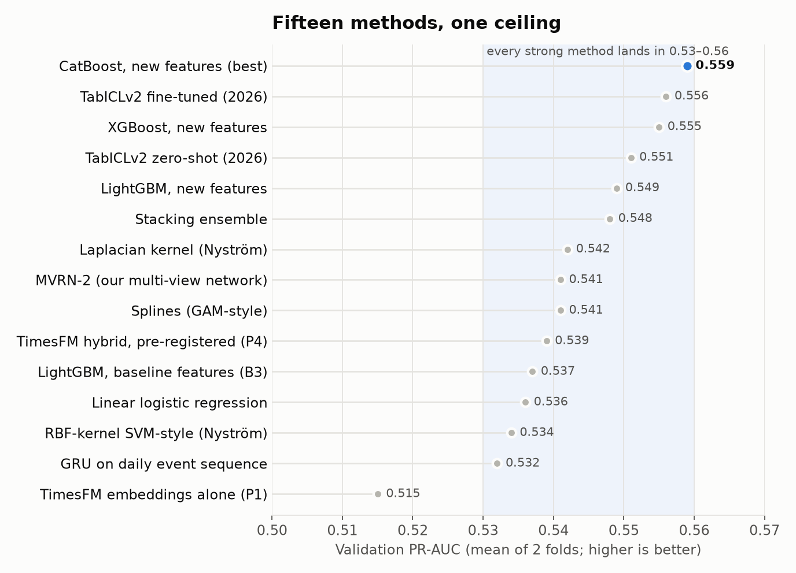

# Do Time-Series Foundation Models Help Predict New-User Engagement?

*A proof-of-concept study on the Zindi New User Engagement Prediction Challenge, testing
TimesFM-3 embeddings against strong classical baselines under a pre-registered protocol.*

**Short answer:** no. The pre-registered test of the TimesFM hybrid is **inconclusive**:
any gain over a tuned LightGBM is smaller than ~0.03 F1 / 0.01 PR-AUC. What *does* work is
modelling the dataset itself: CatBoost on engineered, domain-specific features improves on the
baseline with confidence intervals well above zero. Along the way we found that the
competition's top leaderboard scores are not real F1 (see below).

| | F1 | ROC-AUC | PR-AUC |
|---|---|---|---|
| Tuned LightGBM baseline (B3) | 0.446 | 0.794 | 0.472 |
| TimesFM-3 hybrid, pre-registered candidate (P4) | 0.459 | 0.795 | 0.474 |
| **Best model: CatBoost + domain features (N2)** | **0.482** | **0.812** | **0.505** |
| Best − baseline, 95% CI | +0.036 [+0.018, +0.055] | +0.018 [+0.011, +0.025] | +0.033 [+0.020, +0.045] |

*Test cohorts 3 and 4 (4,278 users), mean of two rolling-origin folds; paired bootstrap with
2,000 resamples. Targeting view: the top 10% of users ranked by the best model return at 3.9×
the base rate.*

## Course deliverables

| Deliverable | Where |
|---|---|
| Presentation (PDF) | `presentation/` (slides exported from the deck) |
| Presentation notebook (executed, rubric order) | [`notebooks/presentation.ipynb`](notebooks/presentation.ipynb) · read-only view: [`docs/presentation_notebook.html`](docs/presentation_notebook.html) |
| Full report | [`REPORT.md`](REPORT.md) (final PDF/notebook report due Oct 10) |
| Code | `src/`, `scripts/`, `tests/` |

The notebook follows the grading rubric: **1** problem & motivation · **2** loading with pandas, X and y ·
**3** preparation (each step motivated) · **4** Seaborn EDA · **5** cross-validation, metric, models and
hyper-parameters · **6** results · **7** impact and conclusion. Rebuild it with
`.venv/bin/python notebooks/build_notebook.py` (needs the data in `data/raw/`).

---

## 1. The problem

[Zindi](https://zindi.africa) (an African data-science competition platform) released masked
logs of its own users: sign-ups, page views, competition participation, submissions,
discussions and comments over seven months. The task: **for each new user, predict whether
they will be active in the month after the month they signed up.**

- 12,413 users, 317k activity events; months and IDs are masked.
- Only **11–20% of new users return**, so the problem is heavily imbalanced; the competition
  metric is **F1**.
- A new user's first month is short and sparse: half of all returning users did 6–20 clicks,
  exactly like users who never come back.

**Research question.** Time-series foundation models (TimesFM-3, Aug 2026) produce
general-purpose representations of time series. Do embeddings of each user's first-month
activity curves add predictive signal beyond strong hand-crafted features?

| Hypothesis | Result |
|---|---|
| H1: TimesFM embeddings *alone* underperform a tuned GBM | **Mixed.** Raw-count embeddings match it; smoothed-curve embeddings are significantly worse. |
| H2: kernel-smoothing sparse events into a dense curve improves the embeddings | **Reversed.** Smoothing hurts (−0.055 PR-AUC). |
| H3: features + TimesFM embeddings beat the GBM | **Inconclusive** under the pre-registered rule (all CIs include 0). |

## 2. The leaderboard is misleading



The final leaderboard's top private scores (0.85–0.87) look far better than anything
achievable here, but they are not F1:

1. **A confirmed scoring bug.** The scorer did not de-duplicate submission IDs, so repeating
   a correctly predicted user inflated F1. A participant showed a score of 0.99 this way.
2. **Accuracy instead of F1.** Participants report that the post-review re-scoring of the top
   entries computed accuracy. With 14.7% positives in the test set, predicting that *nobody*
   returns already scores **0.853 accuracy**, which is exactly where ranks 1–3 sit.
3. **No leak explains it.** We checked: the test users have no next-month rows in any
   released table.

Legitimate entries cluster at **0.42–0.51 F1** (ranks 6–50; a published 12th-place ensemble
scored 0.483). Our results are not directly comparable (different test cohorts, cleaner
label, no tuning on test), but they sit in that same band. Full analysis:
[`results/leaderboard_analysis.md`](results/leaderboard_analysis.md).

## 3. Our results

### Fifteen methods, one ceiling



Linear models, kernel machines (Nyström RBF/Laplacian), GAM splines, LightGBM, XGBoost,
CatBoost, stacking, a GRU over the daily event sequence, two custom neural architectures,
TimesFM-3 used four different ways, and the 2026 tabular foundation model TabICLv2 (zero-shot
*and* fine-tuned) **all land between 0.53 and 0.56 validation PR-AUC**. When methods this
different converge, the limit is the information in a new user's first month, not the model.

### Why TimesFM does not help

- **It discards activity level by design.** TimesFM normalises every series by its own mean
  and spread. Our smoke test shows the embedding of a series and of the same series ×100
  are identical (cosine 1.000), so "1 event on day 5" and "4 events on day 5" look the same.
  Activity level is the strongest predictor of return.
- **Fixing that does not help either.** Prepending a fixed reference patch makes the
  embeddings scale-aware (cosine falls to 0.67 across levels) but gives no validation gain:
  the level is already in the hand-crafted counts.
- **Forecasts add nothing.** TimesFM's zero-shot forecast of next-month activity predicts
  return (AUC 0.72) but is weaker than a plain event count (0.74) and adds nothing to the model.
- **A model that can choose ignores it.** Our multi-view network (below) learns per-user
  weights over its inputs: **4–5% go to the TimesFM view.**

### What does work: modelling the domain

The gain came from features specific to Zindi, all knowable at the end of the signup month:

| Signal (training cohorts) | Next-month return rate |
|---|---|
| 0 / 1 / 2 / 3+ joined competitions still active at month end | 13% / 35% / 43% / 65% |
| First joined a competition < 1 h / 1–24 h / 1–10 days / > 10 days after signup | 32% / 46% / 60% / 76% |
| Never joined a competition | 14% |
| First real action was a competition page (n = 186) vs browsing | 4% vs 26% |

Users who come back days later to join a competition are the most committed; joins in
the first session are often one-off visits from a hackathon link.

### A custom architecture: the Multi-View Retention Network

`src/mvrn.py` implements a network with four views of each user (engineered features,
a GRU over the 31-day event sequence, a TimesFM projection, and an attention-pooled
**set of the user's competitions** with join timing, liveness, momentum and age) fused by a
learned per-user gate. It reaches validation PR-AUC 0.541 (below CatBoost's 0.559 with
only ~4k training users), but its gate is informative:

| View | Learned weight |
|---|---|
| Engineered features | 47–62% |
| Competition set | 15–26% |
| Daily sequence | 17–22% |
| TimesFM embedding | 5% |

## 4. How the evaluation was kept honest

- **Time-based folds.** Users are grouped by signup month; we train on earlier cohorts,
  validate on the next and test on the one after (test cohorts 3 and 4). No random k-fold.
- **No leakage.** Features use only signup-month events; anything fitted (scalers, PCA,
  thresholds, category levels) sees training data only; tests in `tests/` enforce this.
- **Pre-registration.** The H3 decision rule and the candidate-selection rule were written
  into `REPORT.md` before any TimesFM model was run, and are unchanged since.
- **Validation-only development.** Every later idea was developed on validation; final
  model lists were fixed in `results/overnight_protocol.md` *before* a single test evaluation.
- **Data quality fixes found on the way:** a clock offset between tables (+2 h → +1 h step,
  corrected to 99.94% alignment), a one-day badge batch awarded to 2,892 users (removed from
  the label), real month lengths instead of a 31-day grid, and 778 never-tracked users
  (reported as a sensitivity analysis).
- **Label note.** Our primary label excludes the badge batch; the official "any activity"
  label is run as a sensitivity check (it costs every trained model ~0.06 F1).

The full write-up, every table and the pre-registered rule: **[`REPORT.md`](REPORT.md)**.
Decision log: [`results/checkpoints.md`](results/checkpoints.md) ·
exploration log: [`results/overnight_log.md`](results/overnight_log.md) ·
related work: [`results/literature_review.md`](results/literature_review.md).

## 5. Reproduce

The Zindi data is **not included** (Zindi's terms). Download the ten CSVs from the
[competition data page](https://zindi.africa/competitions/zindi-new-user-engagement-prediction-challenge/data)
(free account, accept the rules) into `data/raw/`.

```bash
./scripts/setup_env.sh                       # Python 3.12 env in .venv (uv)
.venv/bin/python scripts/06_make_report.py --rerun   # full pipeline -> results/ + REPORT.md
.venv/bin/pytest                             # leakage, fold and series tests
```

TimesFM embeddings are cached in `results/cache/emb/`; to recompute them add
`--rerun-embeddings` (uses `.venv-tfm`; a GPU is recommended, a CPU works with the
`src/torch_compat.py` shims for torch 2.2). Validation-only experiments:
`scripts/dev/dev_experiments.py` (trees, kernels, stacking, features) and
`scripts/dev/dev_neural.py` (TabICLv2, MVRN, scale-aware TimesFM).

```
notebooks/             presentation notebook (rubric order) and its builder
presentation/          slide deck PDF
docs/                  README figures, Seaborn EDA figures, notebook HTML export
configs/default.yaml   all settings: column mapping, folds, frozen hyper-parameters
src/                   loading, labels, features, series, embeddings, models, evaluation
scripts/00–06          pipeline: audit → dataset → series → baselines → embeddings → models → ablations → report
scripts/dev/           validation-only exploratory experiments
tests/                 leakage, folds, series, verdict-rule tests
results/               metrics CSVs, bootstrap CIs, figures, logs (no raw data)
```

## 6. Limitations

Masked data (month order and calendar inferred from the logs), only five labelled cohorts and
two test folds, short and sparse first-month series, a single dataset, and a label that
deviates from the official one. All are discussed in `REPORT.md`.

## Licence and acknowledgements

Code: MIT (see `LICENSE`). Data: © Zindi, used under the competition rules and not
redistributed. TimesFM-3 weights: TimesFM Non-Commercial License v1.0 (code Apache-2.0).
TabICLv2: Apache-2.0.
